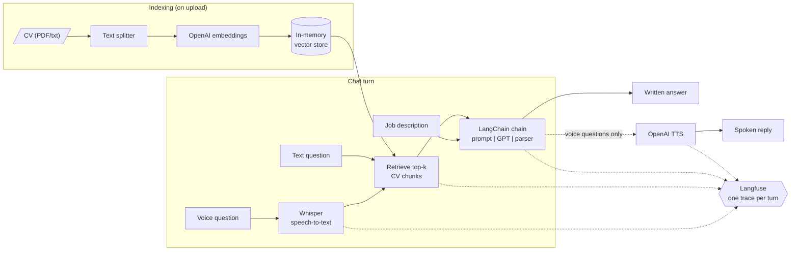

# CV Coach

Voice-enabled career coach. Upload your CV, paste a job description, and ask by text or voice. Answers are grounded in your CV via RAG and every LLM call is traced in Langfuse.



**Stack:** Python, Gradio, LangChain (splitter, embeddings, vector store, chains), OpenAI (chat, embeddings, Whisper, TTS), Langfuse, Docker.

## Run
```bash
cp .env.example .env              # add OPENAI_API_KEY and Langfuse keys
docker compose up --build         # http://localhost:7860
```
Without Docker:
```bash
python -m venv .venv && .venv/bin/pip install -e '.[dev]'
.venv/bin/cv-coach
.venv/bin/pytest
```

See [AGENTS.md](AGENTS.md) for layout and conventions.

## Design notes
- LangChain runs the RAG chain (`prompt | model | parser`); Langfuse's LangChain callback and `@observe` nest STT, retrieval, generation and TTS into one trace per chat turn.
- `InMemoryVectorStore` is enough for a single CV; swap in Chroma/FAISS/pgvector for many documents.
- Built after IBM's *Building Gen AI-Powered Applications* course, replacing its BlenderBot/Code Engine approach with a current LLM API, RAG, observability and Docker.
